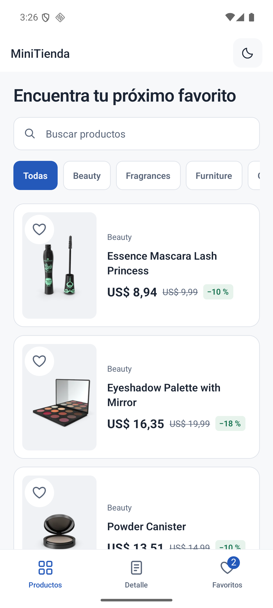
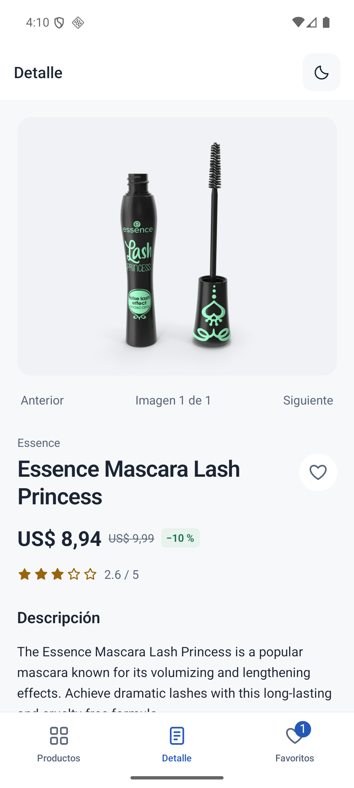
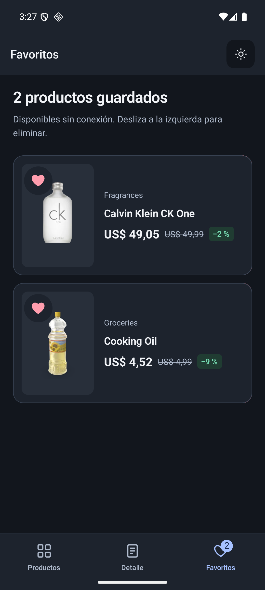

# MiniTienda

Catálogo de productos con búsqueda, categorías y favoritos locales. Hecho con React Native CLI 0.81.6 y TypeScript.

## Requisitos

| Herramienta                  | Versión                                                                              |
| ---------------------------- | ------------------------------------------------------------------------------------ |
| Node                         | 22 LTS, indicada en `.nvmrc`                                                         |
| React Native / Community CLI | 0.81.6 / 20.0.0, instalados en el proyecto                                           |
| Java                         | JDK 17                                                                               |
| Android                      | SDK 36, Build Tools 36.0.0, NDK 27.1.12297006, CMake 3.22.1                          |
| iOS                          | macOS, Xcode 16.4 y simulador instalado                                              |
| Ruby / CocoaPods             | Probado con Ruby 3.3.6, Bundler 2.6.9 y CocoaPods 1.15.2; restricciones en `Gemfile` |

Android requiere configurar `JAVA_HOME`, `ANDROID_HOME` y añadir `platform-tools` al `PATH`. La versión mínima es Android 7 (API 24). Las dependencias están fijadas en `package-lock.json`.

## Ejecutar en Android

Arrancar un emulador desde Android Studio o conectar un dispositivo con depuración USB. Comprobar que aparece en `adb devices`.

```sh
npm ci
npm start
```

En otra terminal, desde la raíz:

```sh
npm run android
```

Para compilar sin instalar, ejecutar `./gradlew assembleDebug --max-workers=2` dentro de `android/` (`.\gradlew.bat` en Windows). El APK queda en `android/app/build/outputs/apk/debug/`. La versión debug necesita Metro.

## Ejecutar en iOS

Desde macOS:

```sh
npm ci
bundle install
bundle exec pod install --project-directory=ios
npm start
```

En otra terminal, ejecutar `npm run ios`, o abrir `ios/MiniTienda.xcworkspace` en Xcode y seleccionar un simulador. Para un dispositivo físico hay que configurar la firma.

El workflow de `codemagic.yaml` permite compilar desde Windows usando una máquina macOS remota. Genera una app Release de simulador sin firma y con JavaScript incluido, comprueba su arranque y publica una captura y los logs. Para utilizarlo en un fork hay que conectar el repositorio a una cuenta propia de Codemagic. Ese control comprueba compilación y arranque; no sustituye una prueba interactiva en iOS.

## Tests y calidad

```sh
npm run lint
npm run lint:format
npm run typecheck
npm test -- --ci --runInBand
```

Jest y React Native Testing Library cubren peticiones y cancelación, hooks, debounce, paginación, descuentos, persistencia, errores y la interacción de las tres pantallas. Las pruebas de navegación usan los navegadores reales para comprobar la pestaña activa y el reinicio del detalle. Las dependencias nativas y la red se simulan en los tests.

GitHub Actions ejecuta estas comprobaciones y compila Android en cada push y pull request. Codemagic se encarga de la compilación y del arranque en simulador iOS.

## Decisiones técnicas

- **Capas:** `api` contiene el cliente HTTP y los endpoints; `domain`, los tipos; `hooks`, las consultas y acciones; `store` y `storage`, los favoritos. Las pantallas se encargan de la presentación y consumen hooks.
- **Zustand + TanStack Query:** separan el estado local del estado del servidor. Los favoritos son globales y reactivos; Query gestiona caché, paginación y cancelación. La búsqueda espera 300 ms y se excluye mutuamente con la categoría.
- **Fetch:** un cliente central configura URL base y timeout en `src/api/config.ts`. Distingue fallos de red, HTTP y timeout, y conecta el `AbortSignal` de Query con `AbortController`.
- **MMKV:** permite guardar favoritos de forma síncrona sin un backend. Se persiste el producto completo, no solo su ID, para mostrarlo sin red. El formato se valida al leerlo y los errores de almacenamiento se muestran con opción de reintento.
- **Navegación:** React Navigation v7, tres Bottom Tabs y un Stack anidado en Productos, con parámetros tipados. Tocar un producto desde el catálogo o Favoritos selecciona la pestaña Detalle. Al salir de ella se limpia la selección; volver a entrar muestra «Elige un producto» hasta abrir otro. Los favoritos y la caché de productos se conservan.
- **Imágenes y listas:** FastImage usa caché nativa para las URLs de DummyJSON. `ProductCard` usa `memo` y un callback estable para evitar renderizar filas sin cambios; la lista usa IDs como claves y elimina duplicados entre páginas.
- **Interacción:** Reanimated 3 anima el favorito de Detalle respetando movimiento reducido. Favoritos permite eliminar por swipe o mediante un botón accesible. Los colores de las pantallas, navegación y controles se adaptan al tema claro y oscuro.
- **Módulo nativo:** `CurrencyFormatter` expone Kotlin (`NumberFormat`) y Swift (`NumberFormatter`) mediante un TurboModule y un adaptador ObjC++. JavaScript lo utiliza para los precios; `Intl.NumberFormat` sirve de respaldo cuando el módulo no está disponible. Los importes son USD, sin conversión de moneda.

## Comportamiento sin conexión

Favoritos lee exclusivamente MMKV y conserva sus datos al cerrar la app. Abrir su detalle intenta actualizarlo por API; si falla, mantiene la información guardada y muestra un aviso con reintento. Las imágenes dependen de la caché del dispositivo y pueden no estar disponibles. El catálogo no se persiste para uso offline.

Para comprobarlo: guardar un producto, reiniciar la app, abrir Favoritos sin conexión y después abrir su detalle. En debug, Metro debe seguir siendo accesible aunque no lo sea la API. Para probar un arranque completamente autónomo, compilar `assembleRelease`; esta prueba utiliza la firma de desarrollo de la plantilla.

## Capturas

  
